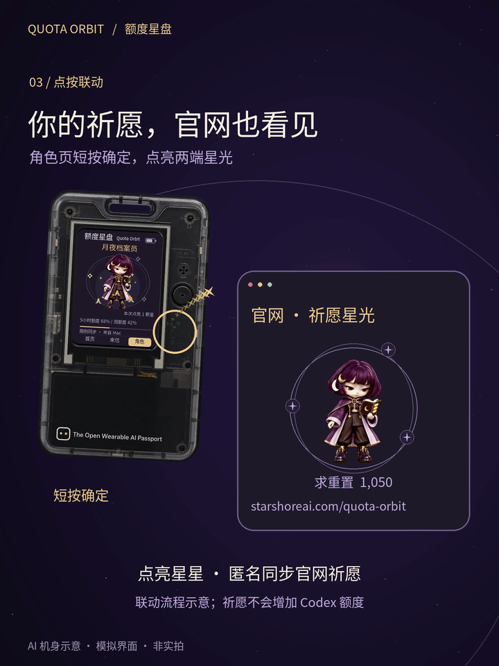
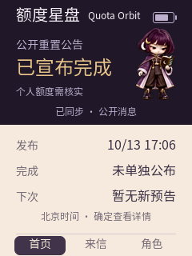
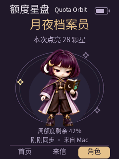

> **当前开发分支：口袋景区导览 v0.5.0。** 本分支构建九寨沟、黄龙离线导览，是独立应用，不是额度星盘更新。请先读[范围、上手、资料与验收](docs/ai-passport/pocket-guide.zh_CN.md)。下方额度星盘文档属于上一应用，不代表本固件含有这些功能；v0.5.0已通过完整构建与主机检查、安装到设备，并经作者确认声音调节、听感与重启音量保存正常；公开发布状态单独记录。

<strong>简体中文</strong> · <a href="docs/ai-passport/device-guide/README.zh_TW.md">繁體中文</a> · <a href="README.md">English</a>

# 额度星盘 · AI Passport Codex 额度与重置提醒

**把 Codex 额度与公开重置消息放在桌边的小屏上，少一次切换窗口查询。** 这是安装在 AI Passport 硬件上的玩法，不是 Mac 桌面应用。

## 安装入口

**① [给 AI Passport 安装玩法](https://ai-passport.folotoy.cn/plays/1250/)** — 用电脑 Chrome / Edge，USB 连接硬件。只看公开消息，到这里即可。

**② [给 Mac 下载个人额度同步助手](docs/ai-passport/mac-helper/README.zh_CN.md)** — 想在角色页看自己的额度，再安装此助手。已公证的 0.3.3 预览版通过 Apple 芯片 macOS 14.8.9、15.7.9、27.0.1 基础运行检查，macOS 11–13 未测；无需安装额度星盘桌面主客户端。

- **看公告：** 设备连上 Wi-Fi，即可独立查看公开预告和完成公告；新消息可用不同提示音提醒，不需要 Mac 或登录 Codex。
- **看自己的额度：** 选装 Mac 同步助手，角色页显示个人剩余额度，月夜档案员手中的书灯随额度变化。
- **轻松互动：** 按确定点亮星星、听祈愿音；来信页微信扫码进入「星岸重置助手」查看详情。

## 第一次来，从这里开始

只看公开公告：**安装设备玩法 → 手机配好 Wi-Fi → 首页显示「已同步 · 公开消息」**，不需要 Mac。想看自己的 Codex 额度：再装 Mac 助手，按下面四步完成一次 USB 配对，看到角色页额度后即可拔线。

- **首页**看当前状态，**来信**看公告解读和时间，**角色**看个人额度与点星互动。
- **官网祈愿首次使用默认开启**：角色页点星会上传匿名事件编号，联动[官网星光](https://www.starshoreai.com/quota-orbit/)，不发送账号或个人额度。长按确定 → 设置 → 官网祈愿可关闭；关闭停止新增并清除待发，已计入的匿名次数不能按个人撤回。[数据与重试说明](docs/ai-passport/wish-sync.zh_CN.md)。祈愿不增加额度。
- 不用编译源码，也不用安装 Python。[完整上手步骤](#第一次使用按这四步) · [Mac 助手安装与同步排查](docs/ai-passport/mac-helper/README.zh_CN.md)。

## 动图预览

约6.4秒无声预览：角色页点星，官网星光回应。机壳为AI示意，界面与联动使用模拟数据，非实机录像；祈愿不会增加Codex额度。

[下载40秒V1完整配乐视频](docs/ai-passport/media/demo-rev3012.mp4) · [一张图上手](docs/ai-passport/media/quick-start-rev3012.png)

| 公开消息：首页／来信 | 个人额度：角色／书灯 |
|---|---|
|  |  |

图片由界面代码渲染，数据为示例，并非实机照片；部分截图可能保留较早文案。**公开重置公告不代表你的个人额度已经恢复；点星也不会增加额度。**

[查看角色额度与点按祈愿效果示意](docs/ai-passport/device-guide/images/role-prayer.jpg)

## 我需要下载什么？

先准备一台 AI Passport。只看公告选第一项；想看个人额度，再加第二项。没有设备可先看 [FoloToy 官方 AI Passport 介绍](https://ai-passport.folotoy.cn/)，是否购买由你决定。

| 用途 | 安装到哪里 | 入口 |
|---|---|---|
| 必装：额度星盘设备固件 | AI Passport 硬件 | [社区作品 1250 → 安装最新版](https://ai-passport.folotoy.cn/plays/1250/) |
| 选装：Passport Mac 同步助手 0.3.3 | Apple 芯片 Mac | [下载与安装说明](docs/ai-passport/mac-helper/README.zh_CN.md) · [Release 附件](https://github.com/koi-lee/quota-orbit-aipassport/releases/tag/passport-helper-v0.3.3) |

设备固件不能装到 Mac；Release 中的 **Source code 是源码，不是安装包**。助手安装包名为 `StarshorePassport-AppleSilicon-0.3.3-notarized.zip`，无需安装 Python。

助手目前是预发布，新版 `-notarized.zip` 已通过 Apple 公证；如 macOS 阻止正常打开，请停止并反馈提示，不要关闭系统安全保护。Intel Mac 和 Windows 尚未提供经过验证的助手安装包。

## 第一次使用，按这四步

1. **安装与配网。** 用电脑 Chrome 或 Edge 打开社区作品页，将开机设备用 USB 数据线连接，点「安装最新版」并选择设备；完成前保持连接。安装会替换当前玩法，可能清除旧设置。手机连接设备屏幕所示 `Starshore-…` 热点，使用屏幕密码；手机浏览器打开 [http://192.168.4.1](http://192.168.4.1)，填写家中 **2.4 GHz Wi-Fi**，点「连接并保存」。设备出现「已同步 · 公开消息」即可看公告。失败重填；超时或换网时，长按确定 → 设置 → 重新配网，再确认。
2. **看消息。** 上下键切换首页、来信、角色。来信页按确定显示小程序码，微信扫码查看详情；再按确定返回。长按确定进设置，可开启提示音或切换简体／繁体／English。
3. **想看个人额度，再装助手。** Mac 先安装并登录 Codex CLI，或使用“应用程序”中的 Codex 桌面应用；两者与设备在同一 Wi-Fi。安装并打开[同步助手](docs/ai-passport/mac-helper/README.zh_CN.md)，USB 连接设备，先点电脑「连接设备」。等硬件启动后，在硬件设置选「连接 Mac」，按确定允许。
4. **确认同步后拔线。** 配对后自动同步，角色页出现个人额度就是成功。可拔 USB；日常保持 Mac 开机唤醒、助手运行。曾手动暂停时点「恢复同步」。角色页短按确定点星；不再使用时，可在设置确认解除 Mac 配对。

公开公告约每 **5 分钟**检查；个人额度约每 **30 秒**同步。来信的「上次同步」是最近一次成功获取公开消息的时间，不是当前时钟。Mac 休眠或两分钟无个人额度更新时显示旧数据、书灯变灰；不提供的额度窗口不会补成 0。

## 更多说明

- [设备页面、按键、配网与同步流程图](docs/ai-passport/device-guide/README.zh_CN.md)
- [社区版本与纯文本读取入口](docs/ai-passport/public-release.zh_CN.md)
- [版本兼容表](docs/ai-passport/COMPATIBILITY.zh_CN.md) · [三语支持说明](docs/ai-passport/language-support.zh_CN.md)
- [Mac 同步助手源码](tools/lan-quota/) · [固件源码](main/) · [构建与发布说明](docs/development/releasing.zh_CN.md)

社区公开更新日志与[版本兼容表](docs/ai-passport/COMPATIBILITY.zh_CN.md)说明安装版本；仓库更新不会自动更新社区固件。当前助手的验证范围和恢复限制见[助手验收与限制](docs/ai-passport/mac-helper/README.zh_CN.md)。Codex 登录凭据留在 Mac，设备只接收加密额度摘要。

## 只想用 Mac 桌面版？

不需要 AI Passport 的桌宠、菜单栏应用在[额度星盘 Mac 主仓库](https://github.com/koi-lee/quota-orbit)。它与本同步助手是独立产品，**使用 Passport 不要求安装额度星盘 Mac 主客户端**。更多产品信息见[额度星盘官网](https://www.starshoreai.com/quota-orbit/)。

## 给 Agent 和开发者

先读 [AGENTS.zh_CN.md](AGENTS.zh_CN.md)，再按[产品上下文与源码导航](docs/ai-passport/product-context.zh_CN.md)定位。安装、个人额度和官网祈愿分别有独立入口；上游硬件示例不代表本玩法的当前界面。

## 仓库内容

`main/`、`components/`、`assets/` 是基于 [FoloToy/ai-passport](https://github.com/FoloToy/ai-passport) 的设备玩法；`tools/lan-quota/` 是 Mac 助手；`docs/ai-passport/` 是安装、页面和语言说明。安装者使用上方社区与助手入口，开发者再查看源码。

## 许可与素材

Mac 同步助手源码遵循 [AGPL-3.0](tools/lan-quota/LICENSE)；固件源码遵循根目录 FoloToy 上游 MIT 许可证及各文件原有声明；字体遵循其随附许可证。月夜档案员角色和正式微信小程序码是额度星盘的产品素材，只授权作为本项目的一部分公开分发，不因此获得脱离本项目使用这些素材的许可；见 [角色素材说明](assets/character/README.md) 与 [小程序码说明](assets/wechat/README.md)。

Quota Orbit 是独立项目，不隶属于 OpenAI 或 FoloToy，也不代表其官方背书。
