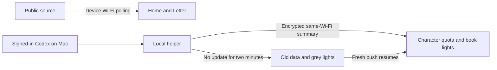

<a href="README.zh_CN.md">简体中文</a> · <a href="README.zh_TW.md">Traditional Chinese</a> · <strong>English</strong>

# AI Passport · Setup and use

**Connect Wi-Fi for public reset news. Add the optional Mac helper for your own Codex quota.** Public news needs no Mac or Codex sign-in. The play displays information; it cannot reset or increase quota.

| Order | Install on | Entry |
|---|---|---|
| Install device firmware first | AI Passport hardware | [Community play 1250 → Install latest](https://ai-passport.folotoy.cn/plays/1250/) |
| Optional helper for personal quota | Apple silicon Mac | [Helper 0.3.0 download and setup](../mac-helper/README.md) |

The Quota Orbit Mac desktop app is not required. Source code archives are for developers, not installers. The new `-notarized.zip` helper is Apple-notarized; if macOS blocks normal opening, stop and report it rather than disabling system protection.

## Setup and controls

1. Open the community play in Chrome or Edge on your computer. Connect the powered-on device with a USB data cable, choose Install latest and select the device. Keep it connected until installation finishes; this replaces the current play and may clear settings. Join the device's displayed Starshore-… hotspot with its displayed password. Open [http://192.168.4.1](http://192.168.4.1), enter2.4GHz Wi-Fi and save. The “Synced · public notices” state confirms success. Retry the form on failure; after timeout or to change networks, hold Confirm and select Settings > Wi-Fi setup.
2. Up/Down switches Home/Letter/Character. Confirm on Home opens Letter, and on Letter opens the WeChat mini-program code; Confirm returns. Tap Confirm on Character for stars; hold for Settings.
3. First use defaults to Simplified Chinese with sound and website wishes on; both can be disabled in Settings. Character-page taps anonymously contribute to the website wish count, not Codex quota. Re-enabling sound previews tap/forecast/completion cues. Updates preserve saved preferences. Public data is polled about every five minutes. Fresh new forecasts or completion notices may sound once; first sync, duplicate and old notices are silent.
4. Optional personal quota: sign in to Codex on the Mac, launch the companion and use the same Wi-Fi. Connect USB, click Connect device on the Mac first, wait for hardware boot, select Connect Mac on hardware and approve. Sync starts automatically after pairing; once quota appears, USB can be removed. Keep the Mac awake and the helper running. Pause/Quit stops pushes; revoke pairing on hardware.

Settings also offers Simplified Chinese, Traditional Chinese and English. Public news is checked about every 5 minutes; personal quota updates about every 30 seconds. “Last sync” is the last successful public fetch, not a clock.

## Data flow

Authentication failure means Wi-Fi did not connect: recheck the household network credentials, not the device hotspot password. After setup timeout, reopen setup in hardware Settings. Public sync failure keeps old notices and retries. Missing quota windows remain unavailable; stale quota requires waking the Mac and restoring sync. Newer firmware supports device address discovery. If it cannot find the device, reconnect through the helper guide; do not revoke pairing as a first step.

## Evidence and limits

Community REV-2886 and later include three-language UI, confirmation screens and address discovery; check the public release notes for the installed revision. Existing user acceptance covers pages, readability, mini-program scan, USB pairing, Wi-Fi sync after unplugging, repeated taps and sound. Controlled forecast/completion and duplicate/mute replay passed. Natural real-message triggering, long-run sleep/network recovery and fresh community installation remain unverified. Only the current Apple silicon Mac was tested; the new `-notarized.zip` helper is Developer ID signed and Apple-notarized. Credentials remain on the Mac; do not share pairing files. Example images do not establish current announcements or account quota.

All example screens and states

## Screens and states

These examples use the firmware's native 240×320 LVGL output, with a separate card combining quota and prayer states; they are not hardware photographs. Announcements, quota, battery, times and hotspot credentials are fictional demonstration values. The [Chinese illustrated guide](README.zh_CN.md) includes the same examples. Home/Letter show public information; Character shows quota supplied by the paired Mac. The top icon is battery charge. Star taps affect only the local star count, while book lights follow synced quota and turn grey after two minutes without fresh data.

### Public completion notice

### Public forecast

### Notice details

### Mini-program code and website address

### Personal weekly quota

### Prayer interaction and book lights

### Settings

### Wi-Fi setup

### Wi-Fi authentication failure

### Cached public notice while offline

### Stale public source

### Old personal quota and grey book lights

### Approve Mac pairing

Some screenshots retain earlier wording; follow the steps above and the current device UI.

