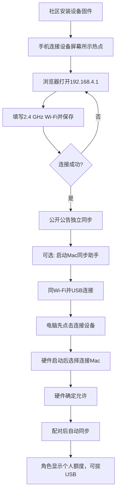
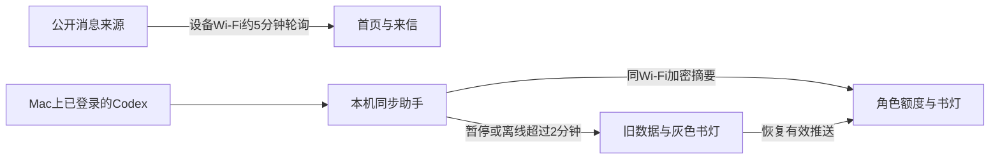
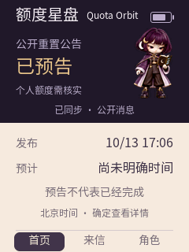
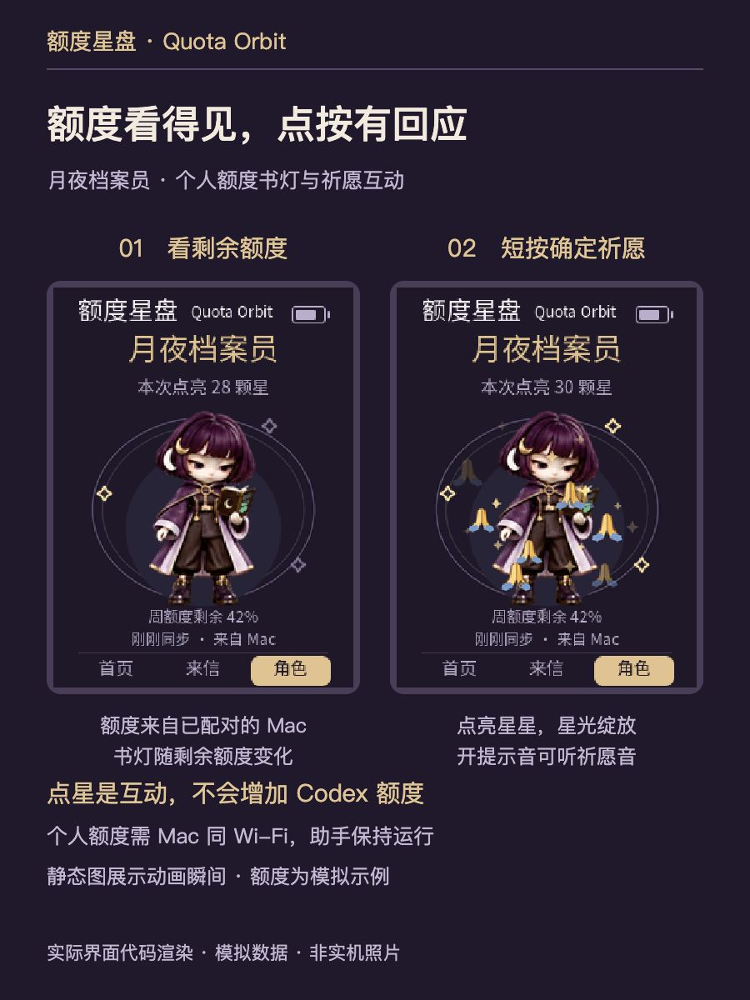
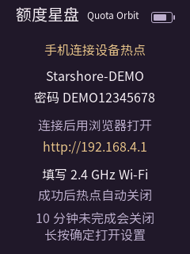
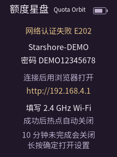
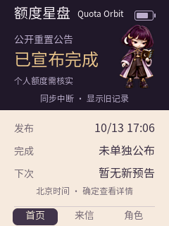

<strong>简体中文</strong> · <a href="README.zh_TW.md">繁體中文</a> · <a href="README.md">English</a>

# AI Passport · 安装与使用

**连 Wi-Fi 看公开重置消息；想看个人 Codex 额度，再选装 Mac 同步助手。** 只看公告不需要 Mac 或 Codex 登录。额度只展示信息，不会替账号重置或增加额度。

| 先后顺序 | 安装位置 | 入口 |
|---|---|---|
| 先装设备固件 | AI Passport 硬件 | [社区作品 1250 → 安装最新版](https://ai-passport.folotoy.cn/plays/1250/) |
| 个人额度选装助手 | Apple 芯片 Mac | [助手 0.3.0 下载与安装](../mac-helper/README.zh_CN.md) |

不必安装额度星盘 Mac 主客户端。Source code 是开发者源码，不是安装包。助手未公证，若 macOS 阻止正常打开，请停止并反馈，不要关闭系统保护。

## 第一次使用

1. 用电脑 Chrome 或 Edge 打开社区作品页，USB 数据线连接开机设备，点「安装最新版」并选择设备，完成前保持连接。安装会替换当前玩法，可能清除旧配置。手机连接屏幕当前显示的Starshore-…热点，使用屏幕密码；浏览器打开[http://192.168.4.1](http://192.168.4.1)，填2.4 GHz Wi-Fi并连接保存。“已同步·公开消息”表示成功。失败可重填；超时或换网时长按确定→设置→重新配网。
2. 设置中可切换简体中文／繁体中文／English。上下键切换首页、来信、角色。首页确定看来信；来信确定显示小程序码，微信扫码进“星岸重置助手”；再按确定返回。角色短按确定点星，长按确定进设置。
3. 提示音默认关，开启后试听点按、预告、完成三类音。公开消息约每五分钟轮询；有效的新预告或完成公告响一次，首次同步、重复和旧消息不响。
4. 个人额度为可选功能：启动配套Mac助手，Mac登录Codex、两者同Wi-Fi。USB连接后先点电脑“连接设备”，等硬件启动，再硬件设置→连接Mac→确定允许。配对后自动同步；角色页出现额度后可拔USB。Mac保持运行、唤醒及登录。暂停/退出停止推送，解除配对在硬件设置确认。

公开公告约每 5 分钟检查；个人额度约每 30 秒同步。「上次同步」不是时钟。角色页两分钟无更新显示旧数据、书灯变灰，缺失窗口不补成零。

## 配网与个人额度流程

## 失败与恢复

| 状态 | 表示什么 | 如何继续 |
|---|---|---|
| 配网认证失败 | 未连接上家庭Wi-Fi | 本地核对Wi-Fi名/密码，重新提交；不是填写设备热点密码 |
| 配网超时 | 临时热点已关闭 | 长按确定→设置→重新配网 |
| 同步中断/来源过期 | 公告同步失败或来源不够新鲜 | 看上次同步时间，保留旧记录；设备继续重试，不能把旧公告当当前结果 |
| 个人额度未提供 | Codex未返回该窗口或尚未同步 | 不显示虚构百分比；检查Mac登录与同步状态 |
| 个人额度旧数据 | Mac暂停、休眠或连接中断 | 恢复Mac和助手；新版固件支持地址发现；若未找回，按助手指南重新连接设备，不必先解除配对 |

## 验证与限制

社区 REV-2886 起包含三语、二次确认及地址发现支持；以社区公开更新日志为准。已有用户验收覆盖三页、中文可读性、小程序扫码、USB配对、拔线后同Wi-Fi同步、连续点星和声音。预告/完成与重复/静音的受控回放通过；真实新公告的自然触发、长期休眠/断网、社区从零完整安装仍待验证。

助手仅当前Apple芯片Mac经过验证，未Developer ID签名/公证；Intel与其他系统未验收。登录凭据留在Mac，密钥留在用户本地；不要分享配对文件。示例图不代表当前公告或个人额度。

展开全部页面与状态示意图

## 设备上能看什么

下图由正式固件的LVGL主机渲染器输出，240×320。公告、额度、电量、时间、热点名和密码都是演示值，不是实机照片或真实账号数据。没有使用私人录像或配对密钥。

| 页面或状态 | 界面展示 |
|---|---|
| 首页：公开完成公告 |  |
| 首页：重置预告 |  |
| 来信：公告与时间 |  |
| 小程序码与官网网址 |  |
| 角色：个人额度与书灯 |  |
| 角色：点按祈愿与书灯 |  |
| 设置：配网、提示音、Mac配对 |  |
| 首次配网：示例热点 |  |
| 配网认证失败 |  |
| 公开消息离线：保留旧记录 |  |
| 来源过期 |  |
| 个人额度：旧数据 |  |
| 首次USB配对：硬件确认 |  |

首页及来信显示公开公告。角色页的个人额度来自已配对Mac，公开重置公告不能推断个人额度到账。右上角图标是电池电量。点亮星星只改变本次星数，书灯使用实际同步的额度；两分钟无更新时变灰并标旧数据。

部分示意图保留较早文案，以当前设备与上方步骤为准。

